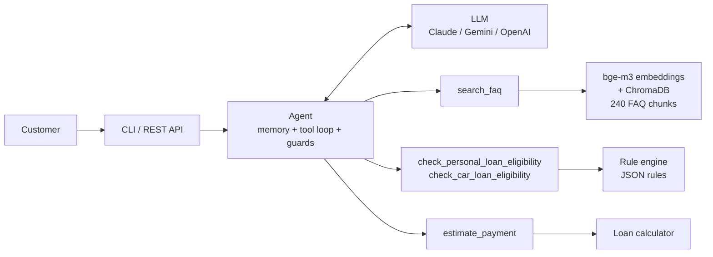

# 🏦 BankWise AI

**A bilingual (Arabic-first) virtual assistant for Banque Misr customers.**
It answers questions about the bank's products from a curated knowledge base and gives a
**non-binding pre-screening** for personal loans and car loans, with every fact traceable to a source.

> **Disclaimer.** BankWise AI is an academic graduation project (DEPI, Round 5). It is **not** affiliated with,
> endorsed by, or approved by Banque Misr. The knowledge base was compiled from public information and may be
> out of date. Nothing the assistant says is financial advice or a loan approval.

---

## Table of contents

1. [Features](#features)
2. [How it works](#how-it-works)
3. [Safety guardrails](#safety-guardrails)
4. [Tech stack](#tech-stack)
5. [Repository structure](#repository-structure)
6. [Getting started](#getting-started)
7. [Running the assistant](#running-the-assistant)
8. [Configuration](#configuration)
9. [Knowledge base and data pipeline](#knowledge-base-and-data-pipeline)
10. [Loan eligibility engine](#loan-eligibility-engine)
11. [Testing](#testing)
12. [Troubleshooting](#troubleshooting)
13. [Known limitations](#known-limitations)

---

## Features

- **Grounded FAQ answers (RAG).** Answers come only from retrieved entries of the bank's FAQ, with citations.
  Covers 18 product areas (debit and credit cards, current accounts, personal loans, car loans, savings
  certificates, digital services, remittances, customer rights, and more).
- **Loan pre-screening.** A rule engine, not the LLM, decides whether a customer is *likely eligible* for a personal
  or car loan, and explains the reasons, suggestions and required documents.
- **Installment estimates.** Monthly payment, total repayment and interest are computed by a calculator that reads
  the rates from the rules files. The LLM never does arithmetic.
- **Multi-turn conversations.** The assistant asks for missing information (age, income, amount, tenor, ...) and
  remembers the last turns of each session.
- **Arabic and English.** It replies in the language the customer writes in.
- **Source footer on every answer.** Sources are built by the code from chunk metadata (document and date), never
  typed by the LLM.
- **Two ways to use it:** a terminal chat and a REST API for a real front end.
- **Pluggable LLM:** Anthropic Claude, Google Gemini, or OpenAI, selected with one environment variable.

## How it works



One customer message goes through these steps:

1. **Input hygiene.** Empty input is rejected and long input is truncated.
2. **Tool loop** (at most 5 LLM-tool round trips). The LLM decides which tool to call. `search_faq` retrieves the
   best FAQ chunks, the eligibility tools run the rules, `estimate_payment` runs the calculator. Tool results are
   handed back to the LLM as data.
3. **Guards enforced in code** (see below): abstain when nothing relevant was found, build the sources footer,
   append the verbatim eligibility disclaimer, and fall back to a fixed message on errors.
4. **History.** The clean turn is saved to the session (last 12 messages are kept).

## Safety guardrails

The system prompt tells the model the rules, **and the code enforces the important ones** so a misbehaving model
cannot break them:

| Concern | How it is handled |
|---|---|
| Hallucinated facts | Facts only from `search_faq` results; each statement carries a `[S1]`-style marker. |
| "I don't know" | Retrieval below a cosine-similarity threshold (`BANKWISE_MIN_SCORE`, default 0.50) means a fixed fallback message, whatever the LLM wrote. |
| Fake sources | The sources footer is generated from the metadata of the chunks that were actually cited. |
| Wrong eligibility or numbers | Decisions come from the rule engine and amounts from the calculator. The LLM only explains them. |
| Approval promises | The bank's own preliminary-assessment disclaimer is appended verbatim to eligibility results. |
| Sensitive data | The assistant never asks for national ID, card numbers, CVV, passwords, PINs or OTPs, and tells customers not to share them. |
| Prompt injection | Retrieved text and tool results are treated as data, never as instructions. |
| Out of scope | Questions not about Banque Misr are politely declined. |
| Stale information | Entries flagged `needs_review`, or about rates and fees, come with a "confirm with the bank" notice and the last-checked date. |
| Runaway loops and errors | Maximum 5 tool steps per message. LLM failures return a safe fixed message, never a stack trace. |

## Tech stack

| Layer | Technology |
|---|---|
| Language | Python 3.10+ |
| Embeddings | `BAAI/bge-m3` via `sentence-transformers` (multilingual) |
| Vector store | ChromaDB (persistent, cosine similarity) |
| LLM providers | Anthropic Claude, Google Gemini (through its OpenAI-compatible endpoint), OpenAI |
| Rules and calculator | Plain Python driven by JSON rule files (no `eval`) |
| Backend | FastAPI + Uvicorn |
| Testing | pytest |

## Repository structure

Run all commands from the repository root (the folder that contains `requirements.txt`).

```
.
├── requirements.txt
├── app.py                     # Streamlit demo UI
├── .env                       # local settings and your API key
├── chatbot/                   # the assistant
│   ├── agent.py               #   orchestrator: memory, tool loop, guards
│   ├── agent_tools.py         #   tool specs and runner (search_faq + eligibility + calculator)
│   ├── llm_clients.py         #   Claude / Gemini / OpenAI adapters
│   ├── prompts.py             #   system prompt
│   ├── retriever.py           #   wrapper around the vector search
│   ├── config.py              #   all settings (env vars)
│   ├── cli.py                 #   terminal chat
│   ├── api.py                 #   FastAPI backend
│   ├── smoke_test.py          #   live end-to-end behaviour check
│   └── tests/                 #   unit tests
├── eligibility/               # loan rule engine
│   ├── eligibility.py         #   executes the JSON rules
│   ├── calculator.py          #   monthly payment / total / interest
│   ├── tools.py               #   tool schemas generated from the rules
│   └── rules/                 #   personal and car loan rules (JSON)
├── embedding/                 # retrieval
│   ├── index_chunks.py        #   embed chunks and store them in Chroma
│   ├── search_chunks.py       #   semantic search
│   ├── eval_retrieval.py      #   hit@k / MRR evaluation
│   └── chroma_db/             #   the prebuilt index (240 chunks)
├── chunking/                  # FAQ JSON -> chunks (prepare_chunks.py, chunks_ar.json, chunks_en.json)
├── data/                      # source FAQ files and loan-rate sync script (api_data/)
├── instructions/              # notes on how to improve retrieval
└── Project Documentation/     # project report and system analysis & design (PDF)
```

## Getting started

**Prerequisites:** Python 3.10 or newer, Git, an API key for one LLM provider, and about 2 GB of free disk space
(the embedding model is downloaded on first run).

```bash
# 1. Clone
git clone https://github.com/tarekmahmoud05/BankWise-AI.git
cd BankWise-AI

# 2. Create and activate a virtual environment
python -m venv venv
venv\Scripts\activate            # Windows
# source venv/bin/activate       # macOS / Linux

# 3. Install dependencies
python -m pip install -r requirements.txt
```

`requirements.txt` leaves the LLM SDKs optional. Install the one you need:

```bash
python -m pip install anthropic   # for LLM_PROVIDER=anthropic (Claude)
python -m pip install openai      # for LLM_PROVIDER=openai AND for gemini (Gemini is called through the OpenAI SDK)
```

**4. Add your API key.** Create a file named `.env` in the repository root (next to `requirements.txt`).

```env
# Option A: Google Gemini
LLM_PROVIDER=gemini
GEMINI_API_KEY=your_key_here

# Option B: Anthropic Claude (the default provider)
# ANTHROPIC_API_KEY=your_key_here

# Option C: OpenAI
# LLM_PROVIDER=openai
# OPENAI_API_KEY=your_key_here
```

## Running the assistant

The first run downloads the `BAAI/bge-m3` embedding model (about 2 GB). Later runs start much faster.

### Terminal chat

```bash
python -m chatbot.cli --debug
```

Type `/new` for a new conversation and an empty line to quit. `--debug` prints the tools used, retrieval score,
latency and token counts after every reply. You can override the settings per run:
`--provider gemini --model <model-name>`.

### Web demo (Streamlit)

```bash
streamlit run app.py
```

Under each answer the demo shows up to 3 *suggested questions* taken from related FAQ entries. The FAQ index is
Arabic, so when the customer is chatting in English the agent translates the suggestions with one extra LLM call
(cached per question; if the translation fails, the suggestions are simply hidden). The same list is returned in
the `suggestions` field of `POST /chat`.

### REST API (for the real front end)

```bash
uvicorn chatbot.api:app --reload
```

The interactive docs are at `http://localhost:8000/docs`.

| Method | Endpoint | Purpose |
|---|---|---|
| `POST` | `/chat` | Send a message and get the reply, sources and diagnostics |
| `POST` | `/reset` | Clear one session's memory |
| `GET` | `/health` | Liveness check |

```bash
curl -X POST http://localhost:8000/chat \
  -H "Content-Type: application/json" \
  -d '{"session_id": "demo-1", "message": "ازاي اكلم خدمة العملاء؟"}'
```

```jsonc
{
  "reply": "...",            // full text to show: body + sources + disclaimer
  "answer": "...",           // body only
  "sources": [{ "ref": "S1", "id": "CON-001", "source_document": "...", "date": "...", "label": "..." }],
  "abstained": false,        // true when the assistant had no reliable answer
  "reason": "",              // "", no_knowledge, empty_input, llm_error, loop_limit
  "tools_used": ["search_faq"],
  "latency_ms": 2300
}
```

`session_id` (1 to 64 characters) identifies a conversation. Sessions are stored in memory only.

### Live smoke test

```bash
python -m chatbot.smoke_test --provider gemini
```

Runs 7 real scenarios (FAQ answer, colloquial question, out-of-scope, complete and incomplete eligibility data,
payment estimate, prompt injection) against the real model, index and LLM, and checks the **behaviour** (right
tool used, abstained when it should, sources present). It uses a handful of cheap LLM calls and exits with
code 1 if any check fails.

## Configuration

Everything is configured through environment variables (usually in `.env`). Defaults live in `chatbot/config.py`.

| Variable | Default | Description |
|---|---|---|
| `LLM_PROVIDER` | `gemini` | `anthropic`, `openai` or `gemini` |
| `LLM_MODEL` | provider default | Model name to use |
| `ANTHROPIC_API_KEY` / `OPENAI_API_KEY` / `GEMINI_API_KEY` | none | Key for the chosen provider |
| `LLM_MAX_TOKENS` | `900` | Maximum tokens per LLM reply |
| `LLM_TEMPERATURE` | provider default | Optional sampling temperature. The provider default is used when unset |
| `LLM_TIMEOUT_S` | `30` | LLM request timeout in seconds |
| `BANKWISE_TOP_K` | `4` | FAQ chunks returned per search |
| `BANKWISE_MIN_SCORE` | `0.50` | Minimum cosine similarity. Below it the assistant says it does not know |
| `BANKWISE_CHROMA_DIR` | `embedding/chroma_db` | Location of the vector index |
| `BANKWISE_COLLECTION` | `bm_faq` | Chroma collection name |

Fixed limits in `config.py`: 5 tool steps per message, 1000 characters per user message, 12 messages of history.
`BANKWISE_MIN_SCORE` is a starting value, and `embedding/eval_retrieval.py` is the tool for evaluating it on real
customer questions.

## Knowledge base and data pipeline

The knowledge base is a set of FAQ JSON files in `data/` (debit cards, current accounts, personal loans, car
loans, and general banking FAQs). **One chunk is one question plus its answer.** Answer text is never modified.
Each chunk carries metadata: product area, source document, access date, language, tags, and a `needs_review`
flag.

Loan-calculator entries are deliberately excluded from the index, because numbers come from the eligibility
engine, not from retrieved text.

Current index: **240 Arabic chunks across 18 product areas**. 100 English chunks are prepared in
`chunking/chunks_en.json` but not indexed yet.

To rebuild the index after changing the FAQ files:

```bash
# 1. FAQ files -> chunk files
python chunking/prepare_chunks.py --input-dir data --output-dir chunking

# 2. Chunks -> embeddings -> ChromaDB (run from embedding/; it writes ./chroma_db)
cd embedding
python index_chunks.py --chunks ../chunking/chunks_ar.json --reset

# 3. Measure retrieval quality (hit@1, hit@3, hit@5, MRR)
python eval_retrieval.py eval_questions.json
```

The index and the query embeddings must come from the same model, so changing the embedding model means
rebuilding the index and re-tuning `BANKWISE_MIN_SCORE`.

## Loan eligibility engine

`eligibility/` contains a deterministic, rule-based pre-screening for **personal loans** and **car loans**.

- Rules live in JSON (`eligibility/rules/*.json`). The engine only executes them, with no `eval`, and each rule
  is a plain Python function selected by name.
- The result is one of `LIKELY_ELIGIBLE`, `NOT_ELIGIBLE`, `NEED_MORE_INFO` (lists exactly which fields are
  missing) or `INVALID_INPUT`, together with reasons, suggestions and required documents.
- Tool schemas for the LLM are generated from the rules files, so allowed values always match the data.
- `eligibility/calculator.py` returns the monthly payment, total repayment and interest. It uses the same
  formula as the engine, so the numbers always agree.
- The assistant collects the inputs conversationally. It only passes values the customer actually stated, and
  asks for anything missing.
- The result is always **preliminary and non-binding**. The assistant does not check the customer's credit
  history.

**Keeping interest rates in sync:** `data/api_data/check_loan_rates.py` compares the interest rates in the rules
files with the bank's published loan programs and updates them after making a backup copy.

```bash
python data/api_data/check_loan_rates.py --dry-run   # only show differences
python data/api_data/check_loan_rates.py             # show differences and update the rules files
```

## Testing

```bash
python -m pytest chatbot/tests eligibility     # unit tests (no API key or model needed)
python -m chatbot.smoke_test                   # live behaviour check (needs an API key)
```

The unit tests use fake LLMs and fake retrieval, so they run in seconds and cost nothing.

## Troubleshooting

| Symptom | Cause and fix |
|---|---|
| `ANTHROPIC_API_KEY is not set` | The default provider is Anthropic. Set `LLM_PROVIDER` (`gemini` or `openai`) in `.env`, or pass `--provider`. The file must be named exactly `.env` and be in the repository root (next to `requirements.txt`). |
| `ModuleNotFoundError: No module named 'openai'` | Gemini and OpenAI are both called through the `openai` package. Install it with `python -m pip install openai`. |
| First start is very slow | The `BAAI/bge-m3` embedding model (about 2 GB) is being downloaded. It is cached for later runs. |

## Known limitations

- **Cross-language retrieval is weaker.** The index is Arabic only, so English questions rely on the
  multilingual embedding model. `instructions/instructions.txt` lists options for improving retrieval
  (indexing both languages, hybrid search, a reranker).
- **No authentication or rate limiting** on the REST API yet.
- **Sessions are in memory,** so they are lost on restart and are not shared between processes.
- **The knowledge base is a snapshot.** Many entries have an estimated access date and some may be outdated.
  Rates and fees should always be confirmed with the bank.
- **No credit-history check.** Eligibility is a pre-screening based only on the information the customer gives.

---

*Built as a graduation project, DEPI Round 5.*
